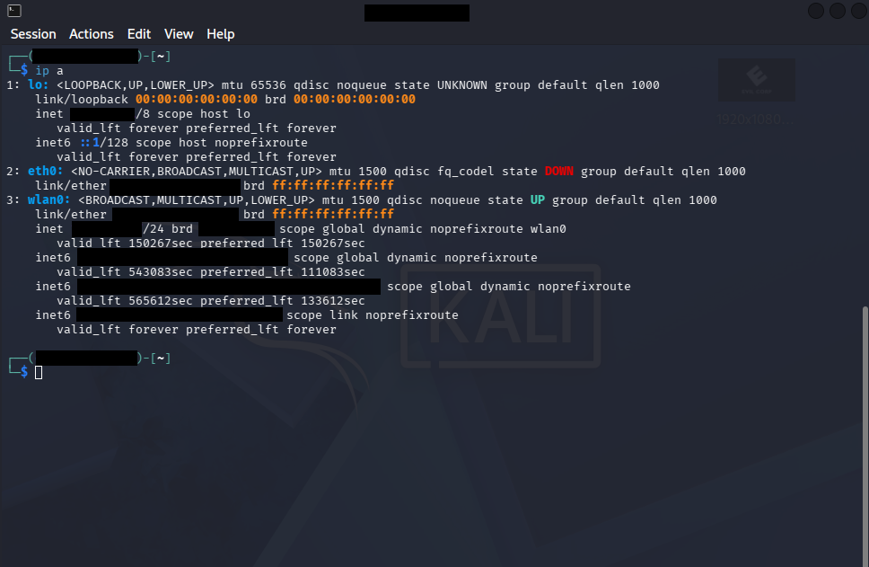

# Home Network Security Assessment & Hardening

## Objective
To assess the security posture of a personal home network using real tools — identifying active devices, validating vulnerabilities against public CVE databases, documenting findings following NIST SP 800-53 standards, and implementing compensating controls where patching was unavailable.

## Skills Learned
- Network reconnaissance and host discovery using Nmap
- CVE research and vulnerability validation (NVD, CVEdetails.com)
- Risk exception documentation aligned to NIST SP 800-53
- Threat modelling and compensating control selection
- VLAN segmentation design and implementation
- DNS-level malware blocking and verification

## Tools Used
- Kali Linux
- Nmap
- NVD / CVEdetails.com
- Cloudflare 1.1.1.2 (Malware Blocking Resolver)
- Home router (VLAN + firewall rule configuration)

## Steps

### Ref 1: Network Interface Identification

Ran `ip a` to identify the active wireless interface (wlan0) and confirm the local IP address before launching the Nmap reconnaissance scan.
