# Home Network Security Assessment & Hardening

## Objective
To assess the security posture of a personal home network using real tools — identifying active devices, validating vulnerabilities against public CVE databases, documenting findings following NIST SP 800-53 standards, and implementing compensating controls where patching was unavailable.

## Skills Learned
- Network reconnaissance and host discovery using Nmap
- CVE research and vulnerability validation (CVEdetails.com)
- Risk exception documentation aligned to NIST SP 800-53
- Threat modelling and compensating control selection
- Network segmentation using guest network isolation on TP-Link AX55
- Router administration hardening (remote management disabled, MAC-based access control, HTTPS enforcement)
- DNS-level malware blocking and verification

## Tools Used
- Kali Linux
- Nmap
- CVEdetails.com
- Cloudflare 1.1.1.2 (Malware Blocking Resolver)
- TP-Link AX55 (guest network isolation + firewall configuration)

## Steps

### Ref 1: Network Interface Identification

Ran `ip a` to identify the active wireless interface (wlan0) and confirm the local IP address before launching the Nmap reconnaissance scan.

### Ref 2: Nmap Ping Sweep — Host Discovery
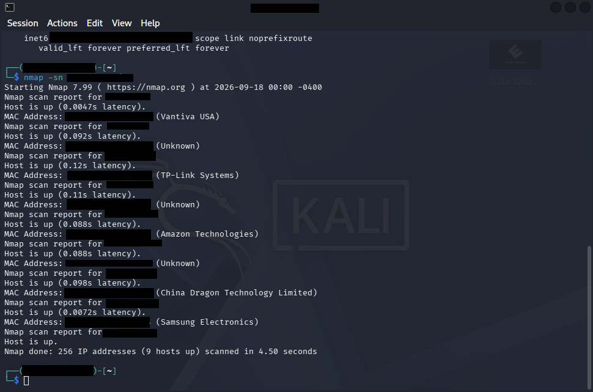

Ran `nmap -sn` across the subnet to discover all active devices. Identified 9 hosts up including a Vantiva USA router, TP-Link access point, Amazon device, Samsung device, and notably a **China Dragon Technology Limited** device — an IPTV device that became the focus of further investigation.

### Ref 3: Nmap Service Version Scan — Router
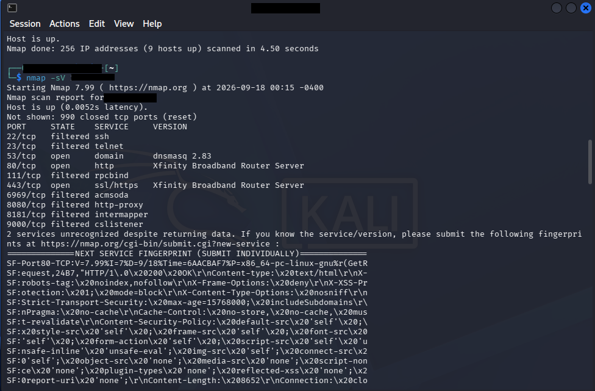

Ran `nmap -sV` against the router (Xfinity Broadband Router Server) to enumerate open ports and running services. Identified open ports on 53/tcp (DNS — dnsmasq 2.83), 80/tcp (HTTP), and 443/tcp (HTTPS). Filtered ports included 22 (SSH), 23 (Telnet), and several high-range ports. Two services returned unrecognized fingerprints flagged for further investigation.

### Ref 4: Scan Results — cat scan_results.txt
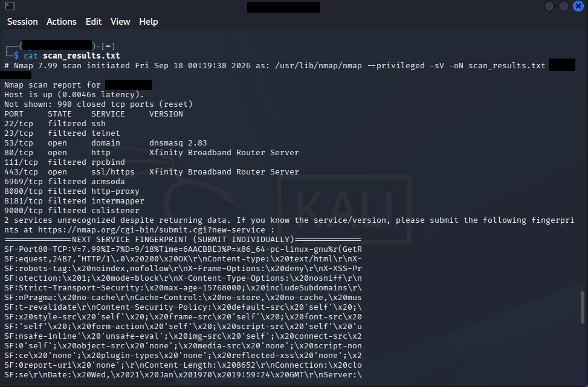

Reviewed saved Nmap scan output from `scan_results.txt`. Confirmed the same open and filtered ports across the target device — 53/tcp (dnsmasq 2.83), 80/tcp and 443/tcp (Xfinity Broadband Router Server). Output saved using `-oN` flag for documentation and evidence purposes.

### Ref 5: Nmap Service Version Scan — IPTV Device (Samba Discovery)
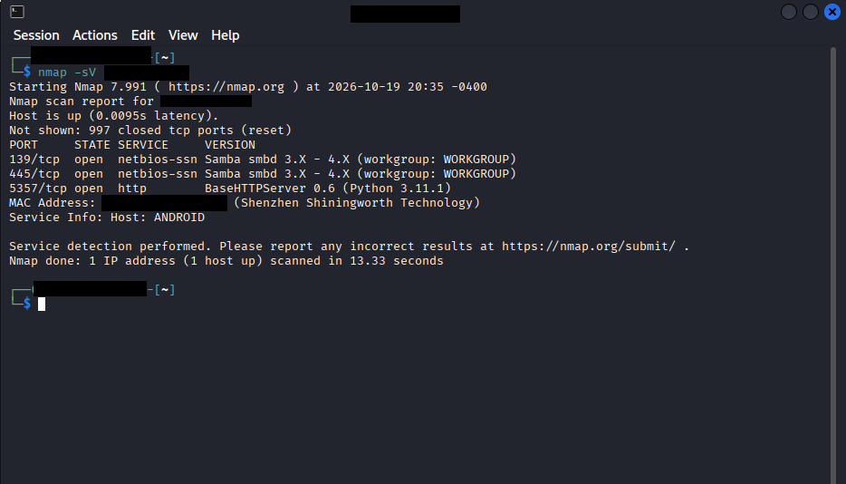

Ran `nmap -sV` against the IPTV device (Shenzhen Shiningworth Technology). Discovered **Samba smbd 3.X - 4.X** running on both 139/tcp (netbios-ssn) and 445/tcp (netbios-ssn), with a BaseHTTPServer on 5357/tcp. `Service Info: Host: ANDROID` confirms end-of-life Android firmware — patching unavailable. This finding triggered CVE research.

> **Note:** The original service version scan was conducted on September 18, 2026 alongside the initial assessment. The screenshot was not captured at the time and was recreated on October 19, 2026 using the same command against the same device, which remains active on the network. Results are consistent with the original findings.

### Step 6 — CVE Research: Identifying the Vulnerability

With `smbd 3.X` identified, I moved to CVEdetails.com to research known vulnerabilities for this version.

**Step 6a — Version Search**

Used the Vendor/Product/Version Search to query `samba / Samba / 3.*` — targeting the exact version branch found on the device.

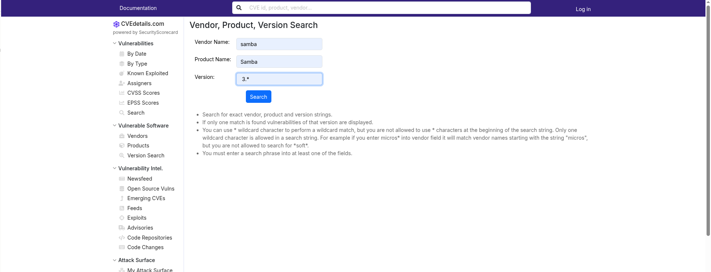

**Step 6b — Version List Results**

Results returned the full 3.X version branch. Each sub-version carried 49–63 known vulnerabilities — confirming this was a high-risk service.

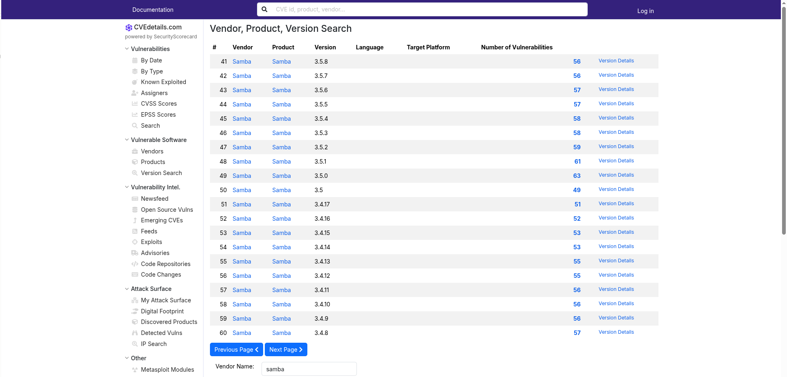

**Step 6c — Filtering for High-Impact CVEs**

Navigated into Samba 3.5.0 and filtered by **2017 / Code Execution** to isolate the highest severity findings.

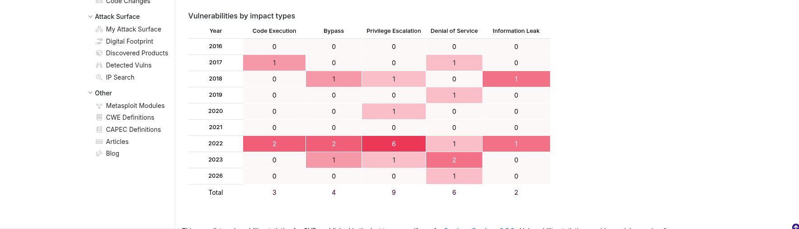

**Step 6d — CVE-2017-7494 Identified**

Filter returned **CVE-2017-7494** — the only Code Execution CVE for this version in 2017. CVSS score: **10.0 (Critical)**. EPSS: **99.45%**. Listed as Known Exploited and used in ransomware campaigns.

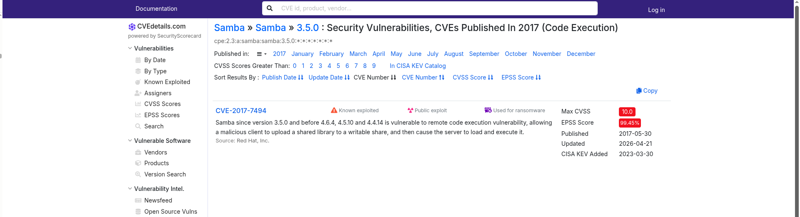

### Step 7 — Risk Assessment

| Field | Detail |
|---|---|
| **CVE** | CVE-2017-7494 (SambaCry) |
| **Affected Service** | Samba smbd 3.X |
| **CVSS Score** | 10.0 — Critical |
| **Impact** | Unauthenticated Remote Code Execution via malicious shared library upload |
| **Device** | IPTV device on home network |
| **Network Exposure** | Internal LAN only — not internet-facing |

---

### Step 8 — Risk Exception Document

A formal risk exception was written documenting:
- Risk owner and acceptance
- Impact and likelihood rating
- Compensating controls in place
- Acceptance timeline and review date

📄 [View Risk Exception Document](risk-exception/CVE-2017-7494-risk-exception.md)

---

### Step 9 — Pre-Segmentation Network Scan

Ran `nmap -sn` against the network after setting up the new router to establish a baseline of all devices reconnected prior to network segmentation being configured.

> ⚠️ *Note: This scan was performed after the IPTV device was physically disconnected from the Rogers ISP router and prior to network segmentation being configured on the new router. The 6 hosts shown represent all devices reconnected to the network at this stage — the IPTV device is absent because it had not yet been reconnected.*

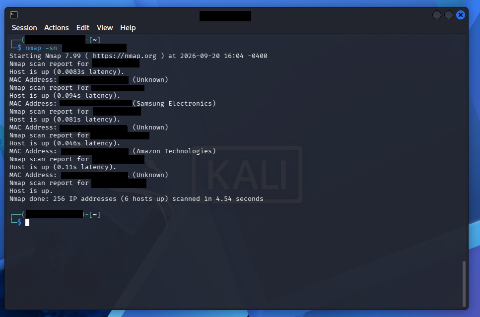

### Step 10 — Compensating Controls: Network Segmentation & DNS Hardening

Unable to patch CVE-2017-7494 directly due to IPTV firmware constraints, the following compensating controls were implemented on the new TP-Link router.

**Network Segmentation — 3 Isolated Networks**

Implemented network segmentation using guest network isolation separating IoT devices from trusted devices on TP-Link AX55 to prevent lateral movement between device types:

| Network | Devices | Purpose |
|---|---|---|
| Main (5G/2.4G) | Laptops, phones | Trusted devices |
| IoT (5G/2.4G) | TVs, IPTV, Firestick | Isolated untrusted IoT |
| Guest (Camera_2G/5G) | Security cameras | Isolated surveillance |

All SSIDs hidden via WPA2/WPA3 encryption to reduce network visibility.

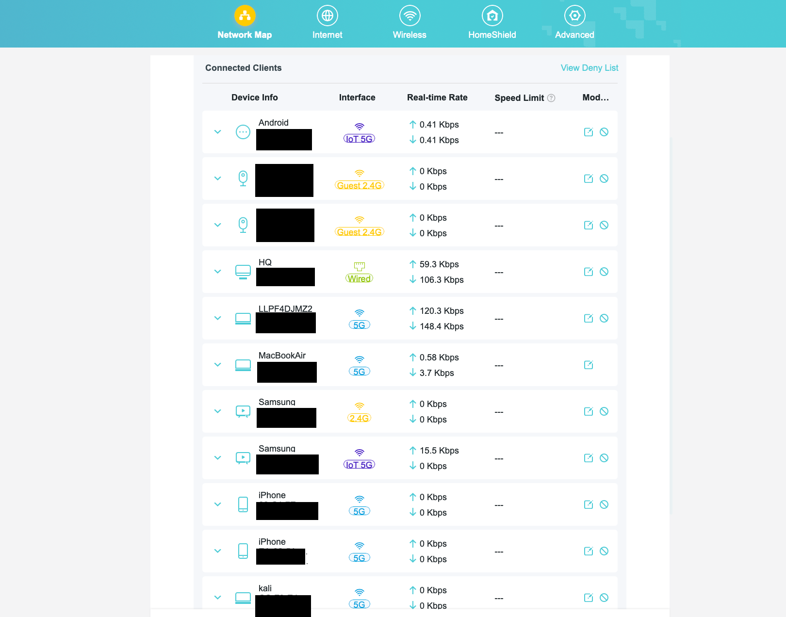

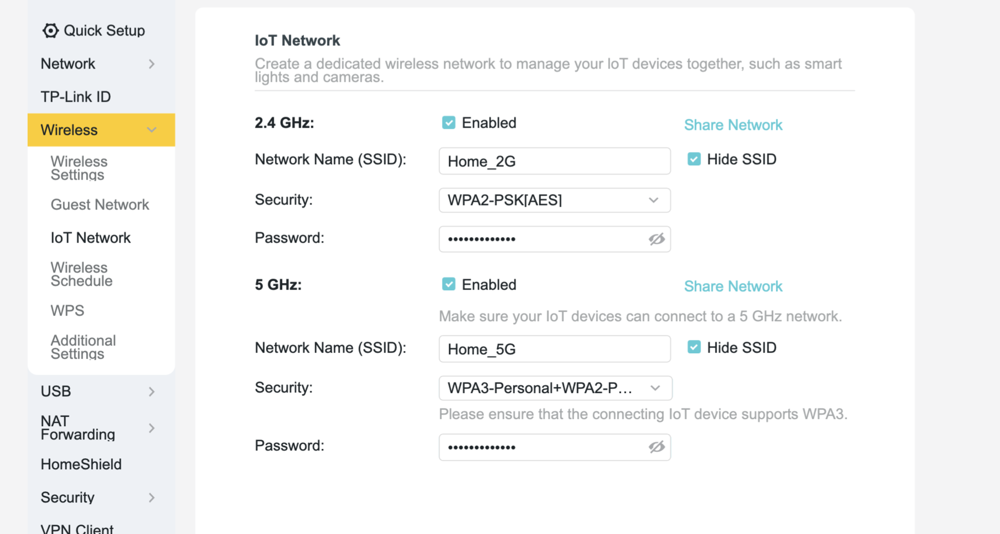

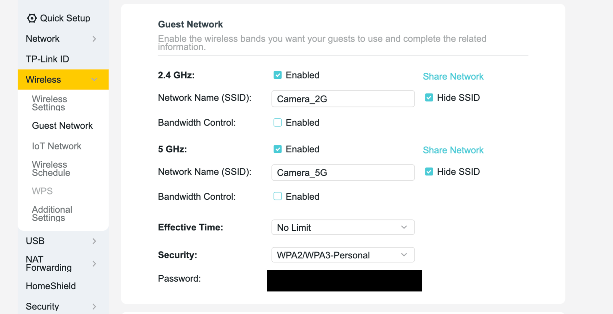

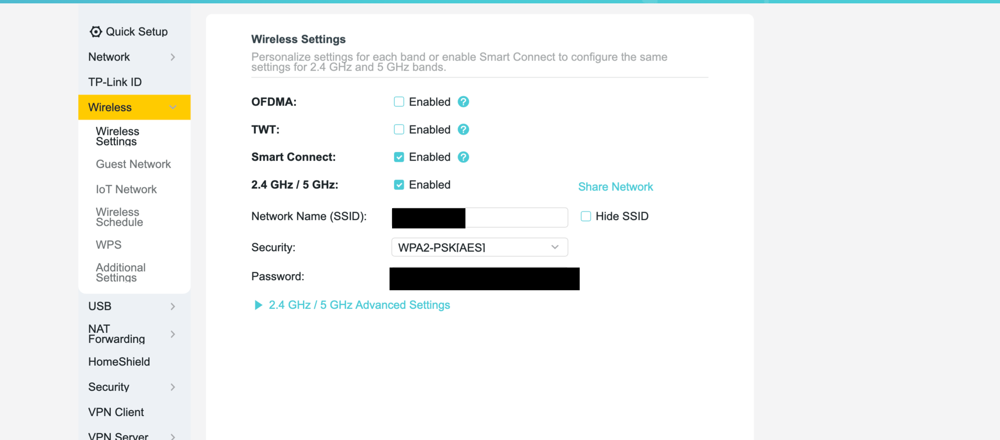

---

**DNS Malware Blocking — Cloudflare 1.1.1.2**

Configured Cloudflare's malware-blocking DNS on the router DHCP server:
- **Primary DNS:** 1.1.1.2 — Cloudflare malware blocking
- **Secondary DNS:** 1.0.0.2 — Cloudflare malware blocking fallback

This blocks known malicious domains at the network level for all connected devices.

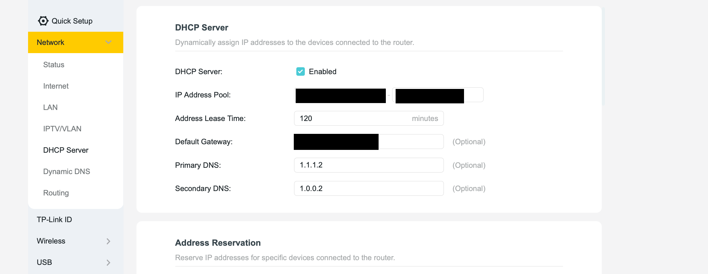

**Network Isolation Verification — Ping Test**

To confirm network segmentation was working, a ping test was run from the Kali machine on the main network targeting devices on the isolated IoT and Guest networks. Both tests returned `Destination Host Unreachable` with 100% packet loss — confirming cross-network communication is blocked.

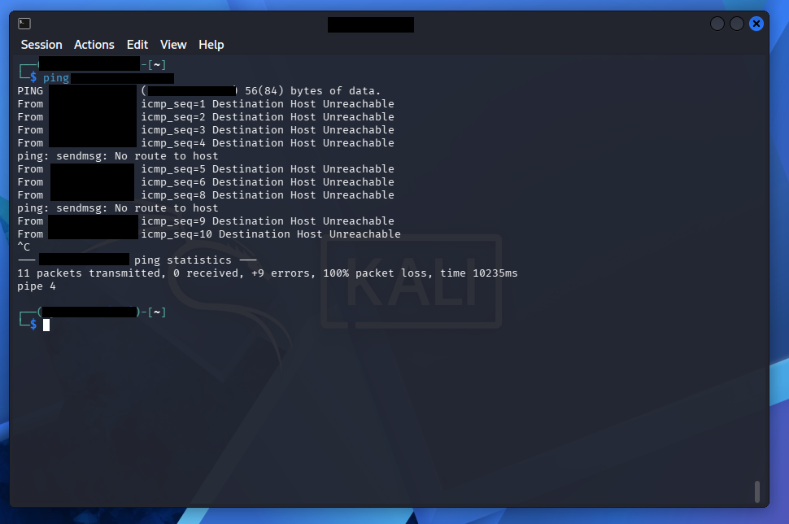

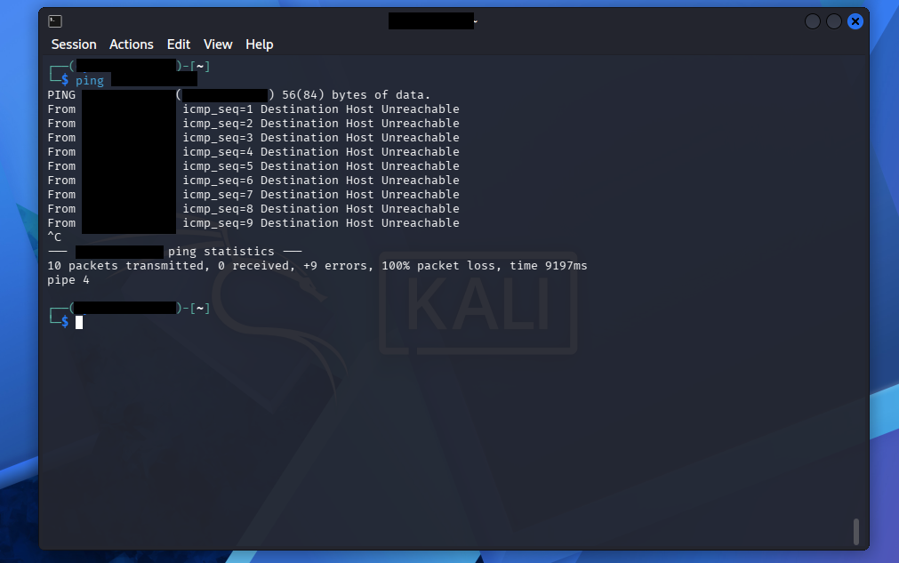
