# Home Network Security Assessment & Hardening

## Objective
To assess the security posture of a personal home network using real tools: identifying active devices, validating vulnerabilities against public CVE databases, documenting findings and risk decisions aligned to NIST SP 800-53, and implementing and testing compensating controls where patching was unavailable.

The project ran in two phases:

| Phase | Period | Summary |
|---|---|---|
| **Phase 1** | Sept–Oct 2026 | Assessment, CVE research, risk exception, and compensating controls on the original consumer router |
| **Phase 2** | Nov 2026 | Router replaced. The vulnerable device was moved to a dedicated quarantine VLAN, IoT and cameras segmented, lost controls restored, and every control re-tested under formal change records |

## Skills Learned
- Network reconnaissance and host discovery using Nmap
- CVE research and vulnerability validation (NVD, CVEdetails.com)
- Risk exception documentation aligned to NIST SP 800-53, with inherent vs. residual risk rating
- Threat modelling and compensating control selection
- VLAN segmentation and deny-by-default firewall zone design (OpenWrt/LuCI)
- Change management: change records, rollback planning, evidence collection
- Control testing, including TTL analysis to prove which device answered a scan
- DNS-level malware blocking, with verification by comparison testing
- Router management hardening and control substitution
- Asset inventory reconciliation and a recurring detective control

## Tools Used
- Kali Linux: Nmap, dig, ping, curl
- CVEdetails.com / NVD
- Cloudflare 1.1.1.2 (malware-blocking resolver)
- Phase 1: consumer Wi-Fi 6 router (guest/IoT network isolation)
- Phase 2: OpenWrt-based Wi-Fi 7 router (GL.iNet admin panel + LuCI)

---

# Phase 1: Assessment & Initial Controls (original router)

> Phase 1 is kept as the historical record. The router used in this phase has since been retired; see [Phase 2](#phase-2-router-upgrade-quarantine-vlan--re-tested-controls).

### Step 1 — Network Interface Identification
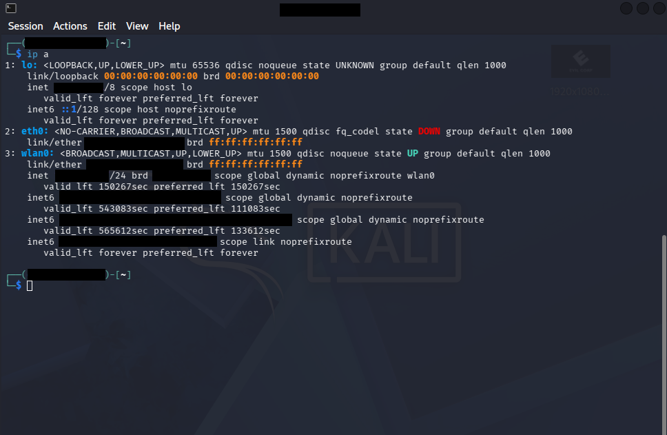

Ran `ip a` to identify the active wireless interface (wlan0) and confirm the local IP address before launching the Nmap reconnaissance scan.

### Step 2 — Nmap Ping Sweep — Host Discovery
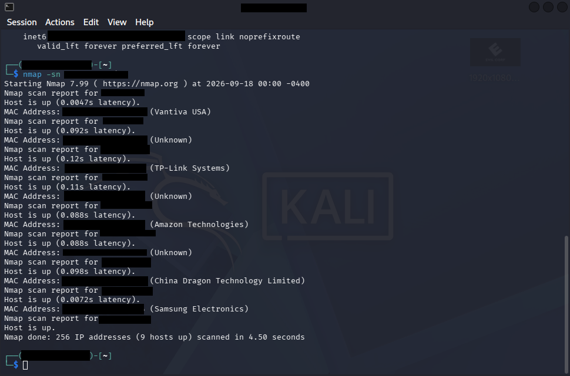

Ran `nmap -sn` across the subnet to discover all active devices. Identified 9 hosts up including a Vantiva USA router, TP-Link access point, Amazon device, Samsung device, and notably a **China Dragon Technology Limited** device — an IPTV device that became the focus of further investigation.

### Step 3 — Nmap Service Version Scan — Router
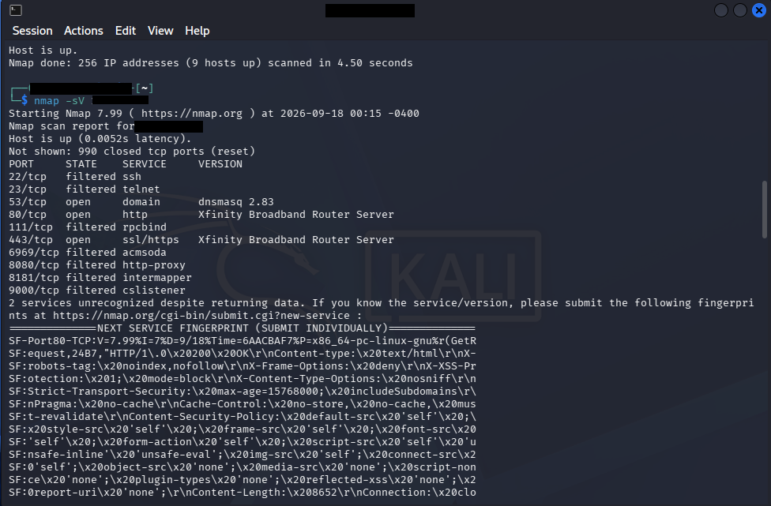

Ran `nmap -sV` against the router (Xfinity Broadband Router Server) to enumerate open ports and running services. Identified open ports on 53/tcp (DNS — dnsmasq 2.83), 80/tcp (HTTP), and 443/tcp (HTTPS). Filtered ports included 22 (SSH), 23 (Telnet), and several high-range ports. Two services returned unrecognized fingerprints flagged for further investigation.

### Step 4 — Scan Results — cat scan_results.txt
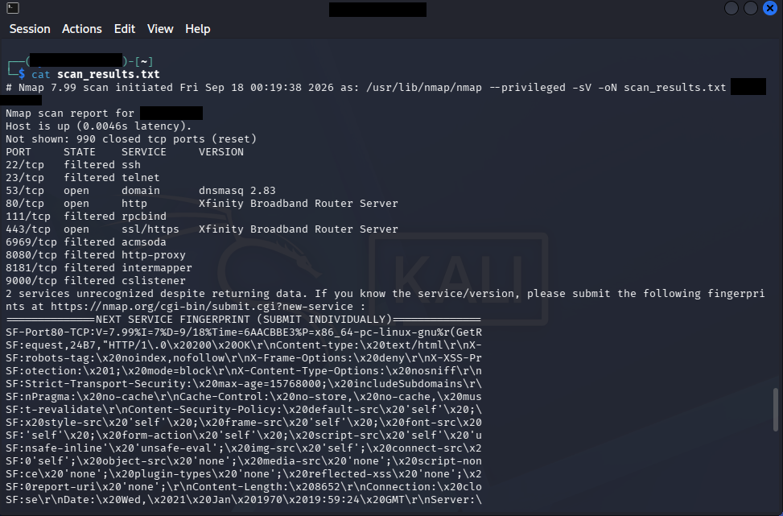

Reviewed saved Nmap scan output from `scan_results.txt`. Confirmed the same open and filtered ports across the target device — 53/tcp (dnsmasq 2.83), 80/tcp and 443/tcp (Xfinity Broadband Router Server). Output saved using `-oN` flag for documentation and evidence purposes.

### Step 5 — Nmap Service Version Scan — IPTV Device (Samba Discovery)
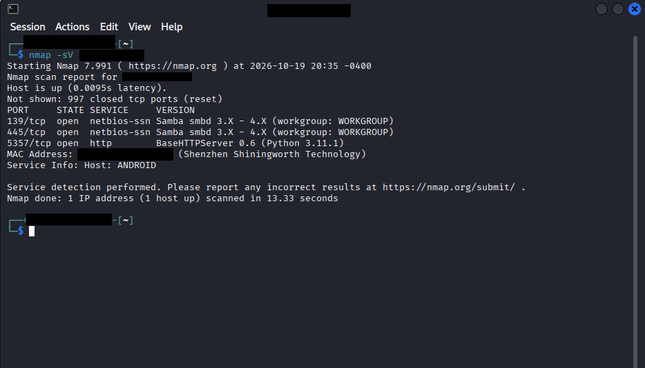

Ran `nmap -sV` against the IPTV device (Shenzhen Shiningworth Technology). Discovered **Samba smbd 3.X - 4.X** running on both 139/tcp (netbios-ssn) and 445/tcp (netbios-ssn), with a BaseHTTPServer on 5357/tcp. `Service Info: Host: ANDROID` confirms end-of-life Android firmware — patching unavailable. This finding triggered CVE research.

> **Note:** The original service version scan was conducted on September 18, 2026 alongside the initial assessment. The screenshot was not captured at the time and was recreated on October 19, 2026 using the same command against the same device, which remains active on the network. Results are consistent with the original findings.

### Step 6 — CVE Research: Identifying the Vulnerability

With `smbd 3.X` identified, I moved to CVEdetails.com to research known vulnerabilities for this version.

**Step 6a — Version Search**

Used the Vendor/Product/Version Search to query `samba / Samba / 3.*` — targeting the exact version branch found on the device.

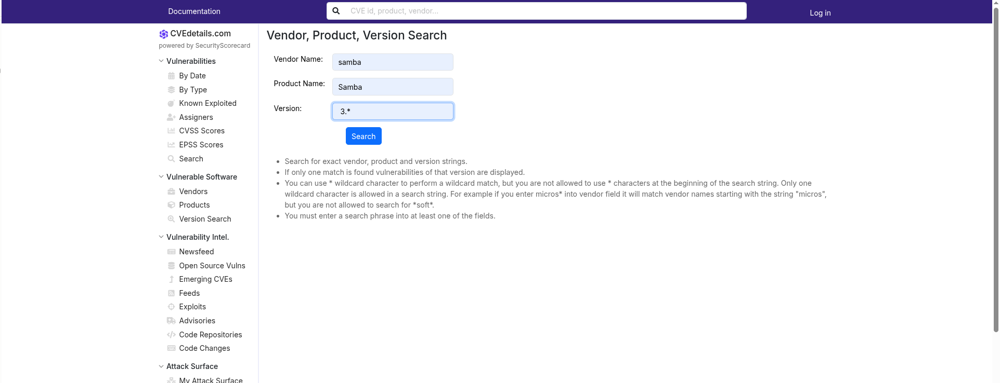

**Step 6b — Version List Results**

Results returned the full 3.X version branch. Each sub-version carried 49–63 known vulnerabilities — confirming this was a high-risk service.

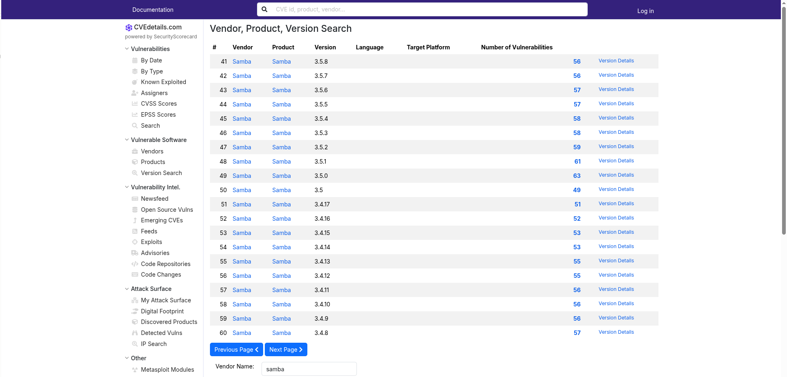

**Step 6c — Filtering for High-Impact CVEs**

Navigated into Samba 3.5.0 and filtered by **2017 / Code Execution** to isolate the highest severity findings.

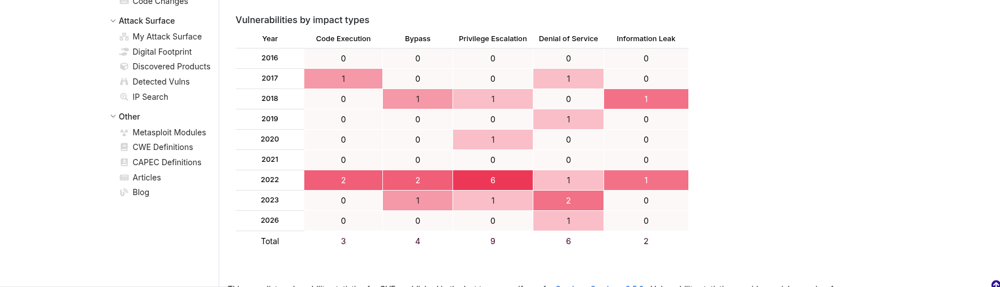

**Step 6d — CVE-2017-7494 Identified**

Filter returned **CVE-2017-7494** — the only Code Execution CVE for this version in 2017. CVSS score: **10.0 (Critical)**. EPSS: **99.45%**. Listed as Known Exploited and used in ransomware campaigns.

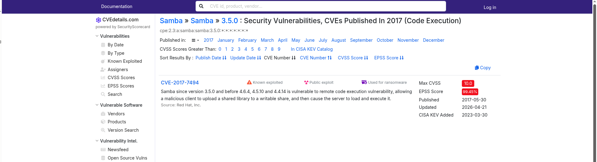

### Step 7 — Risk Assessment

| Field | Detail |
|---|---|
| **CVE** | CVE-2017-7494 (SambaCry) |
| **Affected Service** | Samba smbd 3.X |
| **CVSS Score** | 10.0 — Critical |
| **Impact** | Unauthenticated Remote Code Execution via malicious shared library upload |
| **Device** | IPTV device on home network |
| **Network Exposure** | Internal LAN only — not internet-facing |

---

### Step 8 — Risk Exception Document

A formal risk exception was written documenting:
- Risk owner and acceptance
- Impact and likelihood rating
- Compensating controls in place
- Acceptance timeline and review date

📄 [View Risk Exception Document (current version 2.0)](risk-exception/CVE-2017-7494-risk-exception.md)

---

### Step 9 — Pre-Segmentation Network Scan

Ran `nmap -sn` against the network after setting up the Phase 1 router to establish a baseline of all devices reconnected prior to network segmentation being configured.

> ⚠️ *Note: This scan was performed after the IPTV device was physically disconnected from the Rogers ISP router and prior to network segmentation being configured on the Phase 1 router. The 6 hosts shown represent all devices reconnected to the network at this stage — the IPTV device is absent because it had not yet been reconnected.*

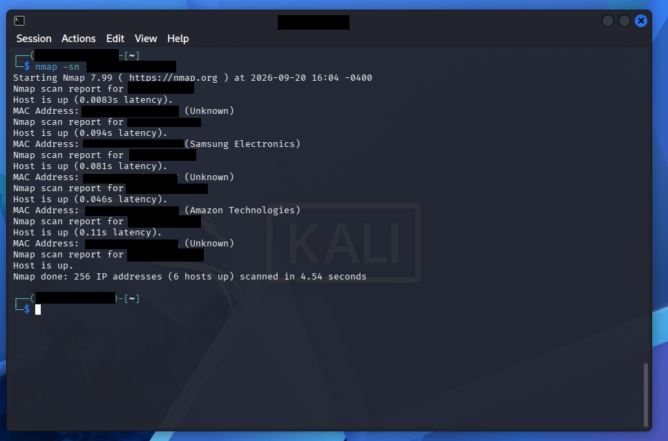

### Step 10 — Compensating Controls: Network Segmentation & DNS Hardening

Unable to patch CVE-2017-7494 directly due to IPTV firmware constraints, the following compensating controls were implemented on the Phase 1 router.

**Network Segmentation — 3 Isolated Networks**

Implemented network segmentation using guest network isolation separating IoT devices from trusted devices on the Phase 1 router to prevent lateral movement between device types:

| Network | Devices | Purpose |
|---|---|---|
| Main (5G/2.4G) | Laptops, phones | Trusted devices |
| IoT (5G/2.4G) | TVs, IPTV, Firestick | Isolated untrusted IoT |
| Guest (Camera_2G/5G) | Security cameras | Isolated surveillance |

Encryption: the main network and IoT 2.4 GHz used WPA2-PSK (AES); IoT 5 GHz and the camera network used WPA2/WPA3 mixed mode. The IoT and camera SSIDs were hidden (the main network was not); hiding reduces casual visibility only and is not relied on as a security control, because hidden networks remain discoverable with standard Wi-Fi tools.

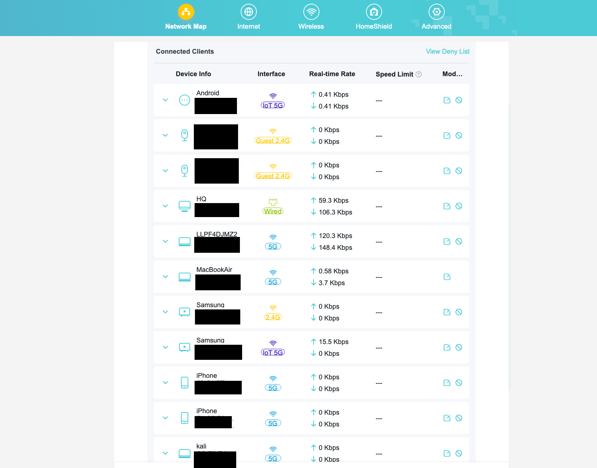

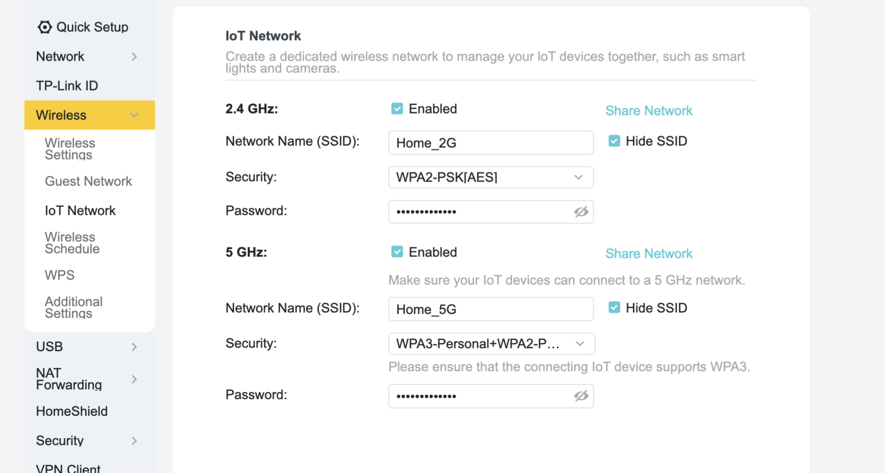

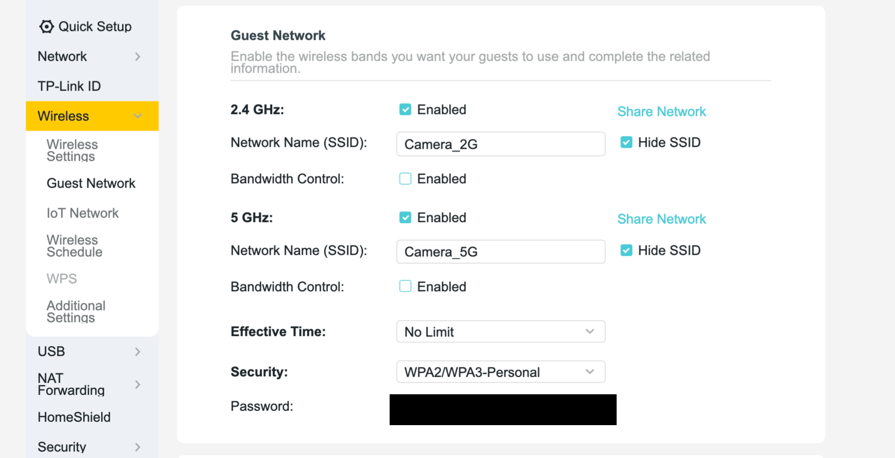

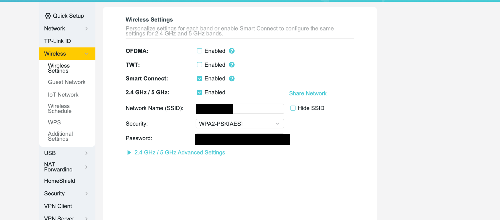

---

**DNS Malware Blocking — Cloudflare 1.1.1.2**

Configured Cloudflare's malware-blocking DNS on the router DHCP server:
- **Primary DNS:** 1.1.1.2 — Cloudflare malware blocking
- **Secondary DNS:** 1.0.0.2 — Cloudflare malware blocking fallback

This blocks known malicious domains at the network level for all connected devices.

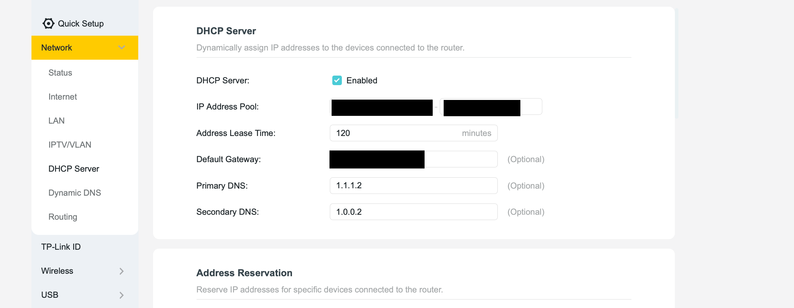

**Network Isolation Verification — Ping Test**

To confirm network segmentation was working, a ping test was run from the Kali machine on the main network targeting devices on the isolated IoT and Guest networks. Both tests returned `Destination Host Unreachable` with 100% packet loss — confirming cross-network communication is blocked.

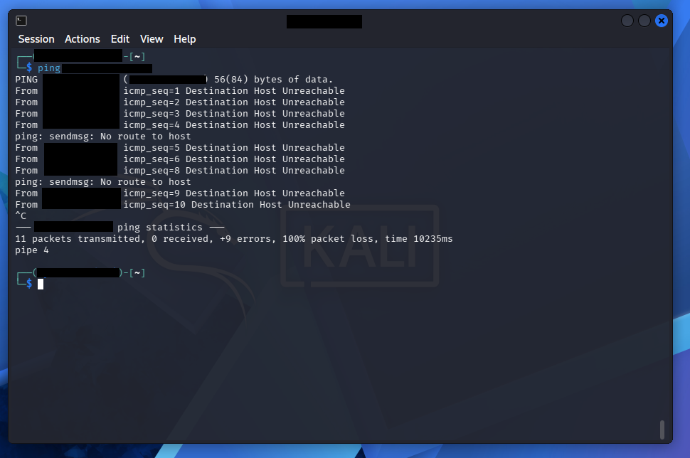

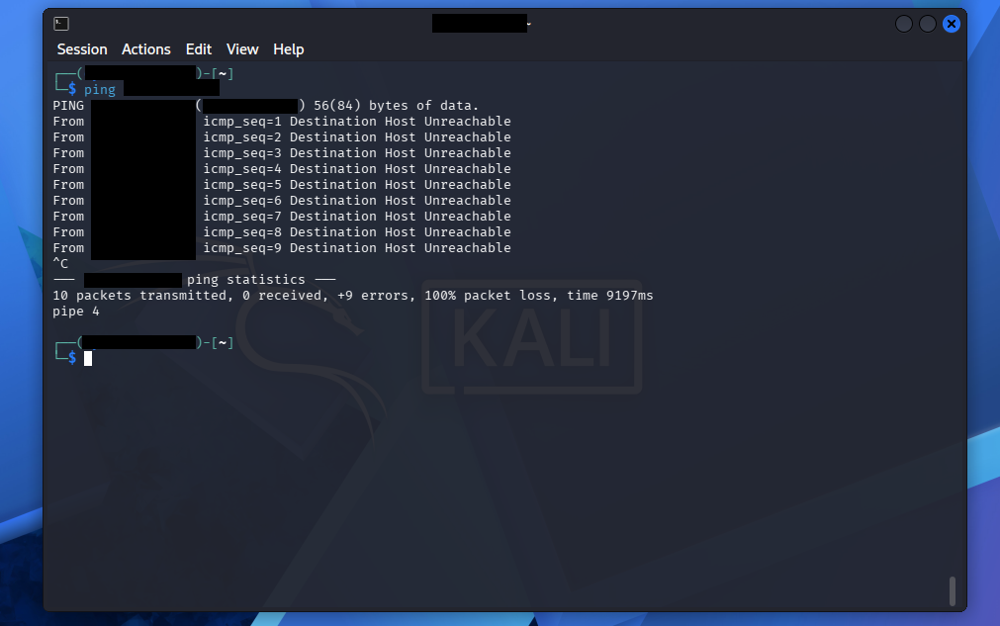

**Router Administration Hardening**

Restricted router management access to reduce the attack surface on the admin interface:

| Control | Detail |
|---|---|
| **Remote Management** | Disabled — no internet-facing admin access |
| **Local Management** | 	Restricted to two authorised devices by MAC address |
| **Management Protocol** | HTTPS enforced — encrypted admin traffic on LAN |

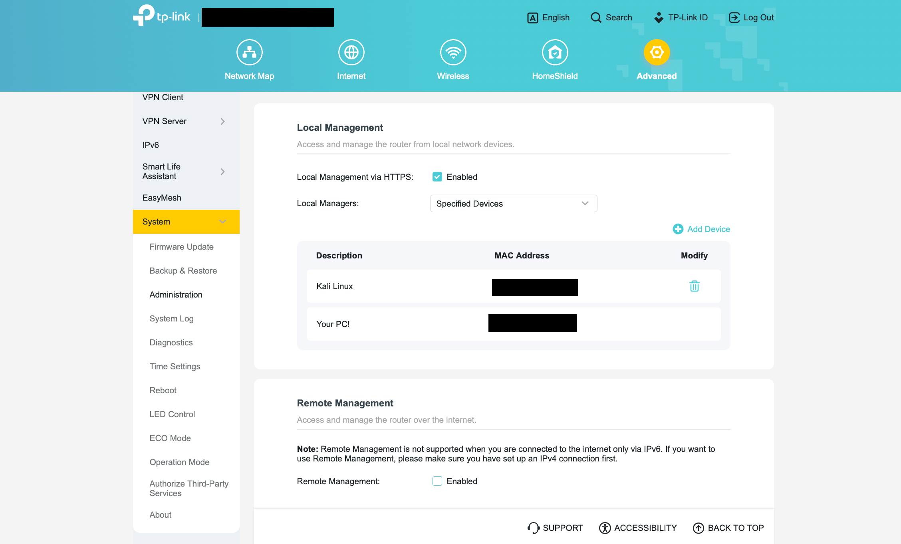

**Phase 1 limitations, identified later:**
- The IPTV box shared the IoT network with TVs and a streaming stick, so it was isolated from trusted devices but not from other IoT devices
- One TV was later found on the **main** network, contrary to the documented policy
- Segmentation was limited to the consumer router's built-in guest/IoT features; there was no firewall rule-level control and no port-level testing
- The risk exception listed "ongoing monitoring of IoT traffic" with no supporting evidence

---

# Phase 2: Router Upgrade, Quarantine VLAN & Re-tested Controls

## Why Phase 2: Risk Treatment Follows Budget

Phase 1 was the best treatment possible on the hardware available. In November 2026 an OpenWrt-based router capable of **real VLANs and per-zone firewall rules** became affordable in a **Black Friday sale**, so the risk could be lowered further.

> Security decisions are cost-benefit decisions. The level of risk you can reduce depends on the budget available to reduce it. Phase 1 accepted more residual risk because that was the affordable option. When a stronger control became affordable, the risk was re-treated and re-rated.

All Phase 2 work was done under formal change records with rollback plans and evidence:

| Change | Scope | Record |
|---|---|---|
| **CHG-001** | Router replacement + IPTV quarantine VLAN | [CHG-001](change-records/CHG-001-iptv-quarantine.md) |
| **CHG-002** | IoT and camera network segmentation | [CHG-002](change-records/CHG-002-iot-camera-segmentation.md) |
| **CHG-003** | Management hardening + DNS malware blocking | [CHG-003](change-records/CHG-003-router-hardening-dns.md) |

## Network Design (Phase 2)

| Zone | Subnet | Devices | Can reach | Reachable from |
|---|---|---|---|---|
| Trusted | `x.x.8.x/24` | Laptops, phones | Internet, router admin | — |
| Camera network | `x.x.9.x/24` | Cameras ×2 | Internet only | **Nothing** |
| IoT network | `x.x.10.x/24` | TVs, streaming stick | Internet only | **Nothing** |
| **IPTV quarantine** | `x.x.30.x/24` (VLAN 30) | Vulnerable IPTV box | Internet only (+ DHCP/DNS) | **Nothing** |

Global firewall defaults: **Input REJECT / Forward REJECT**. A zone can only reach what is explicitly allowed.

## Framework Alignment

Controls are documented against **NIST SP 800-53** (the specific safeguards) and summarized against **NIST CSF 2.0** (the outcomes they support):

| CSF 2.0 Function | Category | SP 800-53 controls | Work |
|---|---|---|---|
| Govern (GV) | Risk management | — | Risk exception with named owner, review cycle and triggers |
| Identify (ID) | ID.RA Risk Assessment | RA-3, RA-5 | CVE research, inherent/residual risk rating |
| Identify (ID) | ID.AM Asset Management | CM-8 | Monthly connected-client review |
| Protect (PR) | PR.IR Infrastructure Resilience | SC-7, SC-7(5), AC-4 | VLAN quarantine, deny-by-default zones |
| Protect (PR) | PR.PS Platform Security | SI-2, CM-3, CM-7 | Firmware patching, change control, SSH off |
| Protect (PR) | PR.AA Access Control | AC-3, AC-17 | Admin restricted by zone, remote access off |
| Protect (PR) | PR.DS Data Security | SC-8 | HTTPS-only administration |

## CHG-001: IPTV Quarantine VLAN

The vulnerable IPTV box was moved to its **own VLAN on a dedicated switch port**, with a firewall zone that forwards only to the internet and accepts nothing in from any other zone. Router firmware was patched to the latest stable release before the build.

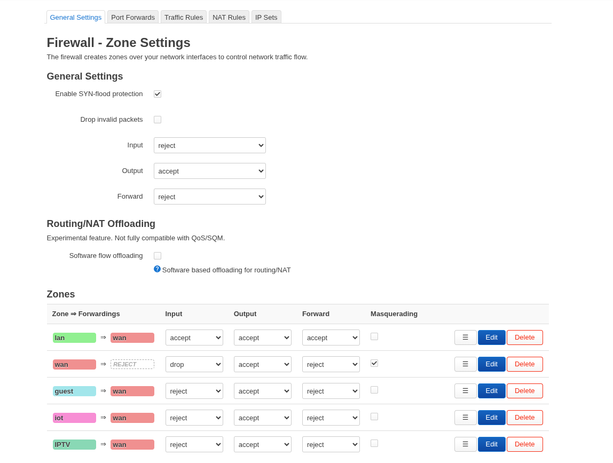

*Global default-deny, with every zone forwarding only to `wan`. No zone forwards into IPTV.*

**Testing (trusted network → IPTV device):**

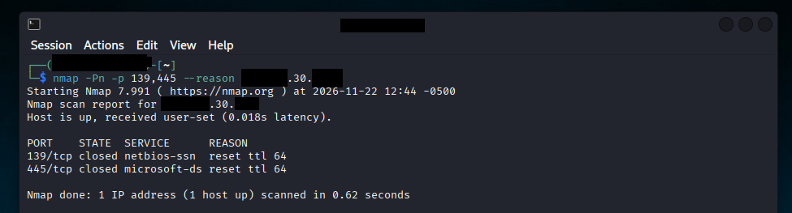

*Ports 139 and 445, the SambaCry attack surface, return `closed` with **`reset ttl 64`**. A TTL of 64 shows the reset came from the router's firewall one hop away; a reply from the device itself would arrive at TTL 63. The scan never reached the vulnerable service.*

| Test | Result |
|---|---|
| Positive control (ping router) | ✅ Works |
| Ping IPTV device | ✅ Rejected by router |
| Nmap 139/445 | ✅ Closed by router (TTL 64) |
| Nmap top 100 ports | ✅ 100/100 closed, 0 open |
| Configuration survives reboot | ✅ Verified |

**Scope:** the inbound path (the one the exploit needs) is **verified by testing**. Outbound isolation (IPTV → trusted) is enforced by firewall policy and **verified by configuration review only**.

## CHG-002: IoT & Camera Segmentation

The Phase 1 policy was carried over: IoT and cameras each got their own network, subnet and firewall zone, with **AP Isolation** and **Block WAN Subnets** enabled. Cameras were kept separate from other IoT because of their higher sensitivity (in-home video). A TV previously found on the trusted network was moved to IoT. Camera viewing works through the vendor cloud, so no inbound exception was needed.

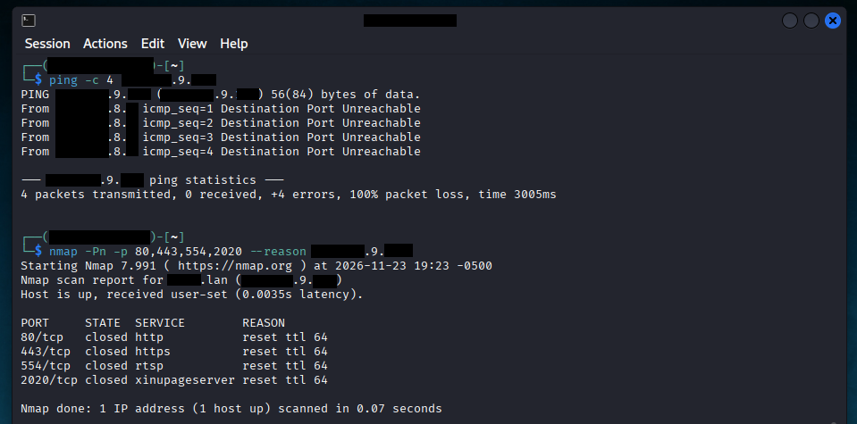

*From the trusted network, the camera's ports (including 554/RTSP video streaming) are closed by the router's firewall.*

## CHG-003: Restoring Lost Controls

**Replacing the router silently removed Phase 1 controls**: DNS malware blocking, admin hardening, and restricted admin access. CHG-003 restored and tested them.

| Phase 1 control | Phase 2 implementation | Tested |
|---|---|---|
| Remote management off | Remote access off; vendor cloud management not enrolled | ✅ |
| HTTPS admin | Force HTTPS (admin panel and LuCI); SSH disabled (on by default) | ✅ |
| Admin restricted by **MAC address** | Admin restricted by **network zone**: untrusted zones can't reach it. Stronger, because MACs can be spoofed | ✅ |
| DNS malware blocking | 1.1.1.2 / 1.0.0.2 + **override for all clients** + DNS rebinding protection | ✅ |
| "Monitoring" (no evidence) | **Monthly connected-client review**, first completed 2026-11-22 | ✅ |

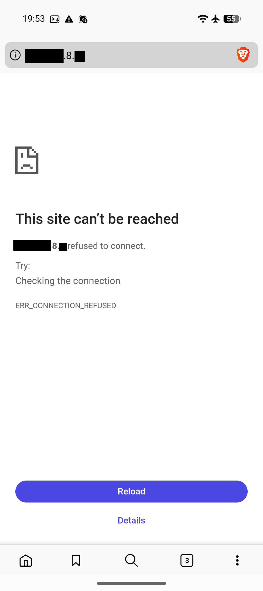

*From the IoT network, the router address where the admin panel listens refuses the connection.*

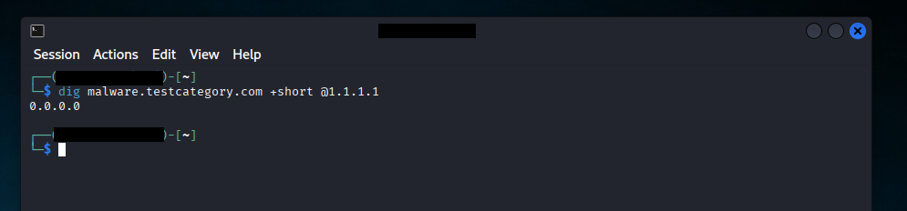

*A query sent directly to an unfiltered public resolver still returns `0.0.0.0`: the router intercepts and filters DNS even for devices that try to bypass it.*
